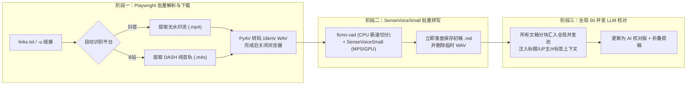

# video-to-text：抖音 & B 站视频批量转 Markdown 文稿工具

基于 `uv` + **Playwright（持久化登录态）** + **阿里 SenseVoiceSmall (`funasr`)** + **全局高并发 LLM 保真校对** 构建的本地抖音与 B 站视频批量转文字命令行工具。

---

## ✨ 核心特性

- **🔗 抖音 + B 站双平台混排识别**：支持在同一个 [`links.txt`](links.txt) 中任意混填抖音分享口令（`v.douyin.com` / `douyin.com/video/...` / `discover?modal_id=...`）与 B 站分享文案（`b23.tv` 短链、`BV`/`av` 长链及 `?p=N` 多 P 链接），自动剔除追踪参数并去重。
- **⚡ 三阶段解耦流水线**：
  1. **阶段一（批量音频提取）**：复用单实例 Playwright 批量解析并流式下载音频（带实时网速与进度条），B 站直接提取几 MB 的 **DASH 独立纯音轨 (`.m4s`)** 极速下载，全部下载完毕后立即关闭浏览器释放内存。
  2. **阶段二（异构加速语音识别）**：仅加载一次阿里 `SenseVoiceSmall` 模型权重，采用 **`CPU (fsmn-vad 切分) + MPS/GPU (SenseVoice 批量推理)`** 混合加速策略，40 分钟长课程音频约 10 秒完成转写，每篇转完立即落盘保存初稿 `.md` 并清理临时音频。
  3. **阶段三（全局大并发 AI 保真校对）**：将本批次所有视频的所有文本分块汇总投入**同一个全局并发池（默认最高 `50` 并发）**同时请求大模型，结合视频标题、作者/UP 主及 `#话题标签` 修复同音错别字与专有名词，同时用 `<details>` 折叠块保留原始识别文本。
- **🍪 持久化账号登录态**：通过 `uv run video-to-text login` 扫码一次，双平台 Cookie 永久保存在本地 `.browser_profile/` 目录中，远离滑块验证码与未登录限制。
- **📦 免安装系统 `ffmpeg`**：内置 `av` (PyAV) 动态库，直接在内存与本地将 `.mp4` / `.m4s` 重采样为 `16kHz` 单声道 WAV。
- **🔄 断点续转与存量独立校对**：自动跳过输出目录中已存在的作品 ID（支持分 P 独立 ID 如 `BV1xx_p2`）；支持通过 `check` 命令对已生成的初稿 `.md` 随时补充执行大模型校对。

---

## 🏗️ 工作流架构



---

## 🚀 快速开始

### 1. 环境安装（首次克隆项目）

确保本机已安装 [`uv`](https://docs.astral.sh/uv/)，在项目根目录执行：

```bash
# 安装 Python 3.12 虚拟环境与全部依赖
uv sync

# 安装 Playwright Chromium 浏览器内核
uv run playwright install chromium
```

### 2. 扫码保存抖音 / B 站登录态（推荐，只需执行一次）

```bash
# 默认同时打开抖音和 B 站两个标签页
uv run video-to-text login

# 或单独指定登录某个平台
uv run video-to-text login -p bilibili
uv run video-to-text login -p douyin
```

在弹出的浏览器窗口中使用手机 App 扫码登录，登录成功后**直接关闭浏览器窗口**（或在终端按 `Ctrl+C`）即可永久保存在本地 `.browser_profile/`。

### 3. 配置大模型保真校对（可选）

复制 [`.env.example`](.env.example) 为 `.env`，填入你的 OpenAI 兼容接口密钥（支持 DeepSeek、阿里云通义千问、硅基流动、Kimi、OpenAI、本地 Ollama 等）：

```bash
cp .env.example .env
```

`.env` 配置项说明：

| 变量名 | 默认值 | 说明 |
| :--- | :--- | :--- |
| `LLM_API_KEY` | 无（必填以开启校对） | OpenAI 兼容接口的 API Key（本地 Ollama 可填 `ollama`） |
| `LLM_BASE_URL` | `https://api.deepseek.com/v1` | 接口地址（如阿里百炼 `https://dashscope.aliyuncs.com/compatible-mode/v1`） |
| `LLM_MODEL` | `deepseek-chat` | 使用的模型名称（如 `deepseek-chat`、`qwen-plus` 等） |
| `LLM_MAX_CONCURRENCY` | `50` | 全局并发请求上限 |

---

## 💻 常用命令详解

### 1. 批量转换视频（`run`）

将抖音分享口令或 B 站链接粘贴到 [`links.txt`](links.txt) 中，运行：

```bash
# 完整流程：批量下载 -> 语音转文字 -> 全局并发 AI 校对
uv run video-to-text run links.txt -o ./output

# 跳过大模型校对，仅执行本地 SenseVoiceSmall 语音转文字
uv run video-to-text run links.txt -o ./output --no-llm

# 直接在命令行转换单条或多条链接（支持分 P）
uv run video-to-text run -u "https://www.bilibili.com/video/BV1xxxxxx?p=2"

# 强制重新下载并转换已存在的作品
uv run video-to-text run links.txt --force

# 显示浏览器窗口（遇到风控滑块需手动排查时使用）
uv run video-to-text run links.txt --no-headless
```

### 2. 对已生成的 `.md` 文稿单独执行大模型校对（`check`）

如果之前使用了 `--no-llm` 仅生成了语音识别初稿，后续无需重新下载视频或重跑语音识别，直接运行：

```bash
# 批量校对 ./output 下所有尚未校对的 .md 文稿（全局 50 并发）
uv run video-to-text check ./output

# 对单个 .md 文件执行校对
uv run video-to-text check ./output/某某作者_视频标题_123456.md

# 对已经校对过的文稿强制重新校对（会自动从 <details> 提取原始初稿重校）
uv run video-to-text check ./output --force
```

---

## 📄 输出 Markdown 文稿示例

每个视频会在 `output/` 下生成独立的 `{作者}_{标题前30字}_{作品ID后6位}.md` 文件：

```markdown
# 深入理解计算机系统精讲 (P2 信息的表示和处理)

- **平台**：B站 (bilibili)
- **作者**：硬核计算机UP主
- **作品 ID**：`BV1xx411c7mD_p2`
- **原链接**：https://www.bilibili.com/video/BV1xx411c7mD?p=2
- **发布时间**：2026-11-01 18:00:00
- **转换时间**：2026-11-05 20:30:00
- **识别耗时**：8.42s
- **AI 校对模型**：`deepseek-chat` (12.15s)

## 视频原简介

> 本课程带你精读 CSAPP 核心章节
> #计算机科学 #CSAPP

## 语音转文字正文（AI 校对版）

（此处为修正同音错别字与标点断句后的保真正文...）

<details>
<summary>查看原始语音识别文本 (SenseVoiceSmall)</summary>

（此处折叠保留 SenseVoiceSmall 原始识别文本，方便随时对比...）

</details>
```

---

## 📂 项目结构

```text
video_to_text/
├── src/video_to_text/
│   ├── cli.py           # Typer 命令行入口 (login / run 三阶段流水线 / check)
│   ├── parser.py        # 抖音 & B 站链接提取、追踪参数清洗、多 P 与平台识别
│   ├── downloader.py    # Playwright 持久化登录、流拦截、DASH 纯音轨下载与 PyAV 转码
│   ├── transcriber.py   # 阿里 SenseVoiceSmall + fsmn-vad 本地异构加速语音转写
│   ├── llm_checker.py   # OpenAI 兼容接口全局并发池保真校对器
│   ├── exporter.py      # Markdown 模板渲染、断点续转检测与存量文稿解析
│   └── models.py        # 核心数据类 (VideoMetadata / TranscriptResult)
├── tests/
│   └── test_core.py     # pytest 自动化单元测试套件
├── links.txt            # 待转换的抖音/B站分享口令与链接列表
├── .env.example         # 大模型 API 环境变量配置模板
└── pyproject.toml       # uv 项目配置与依赖声明
```

## 🧪 运行单元测试

```bash
uv run pytest -v
```
